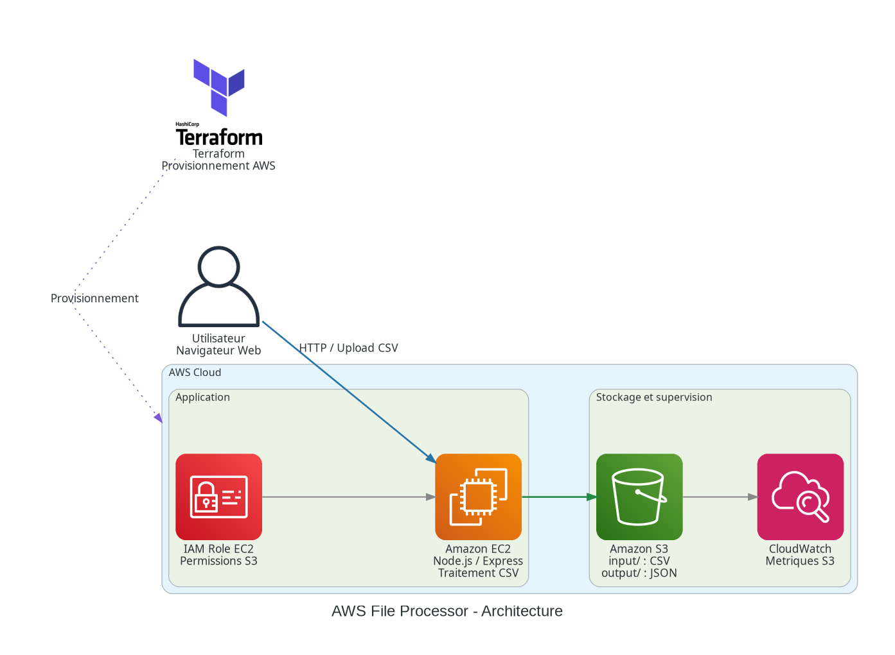
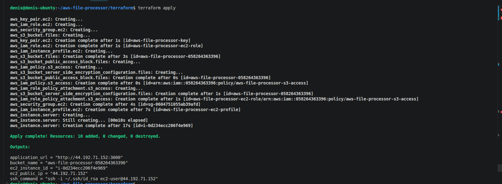
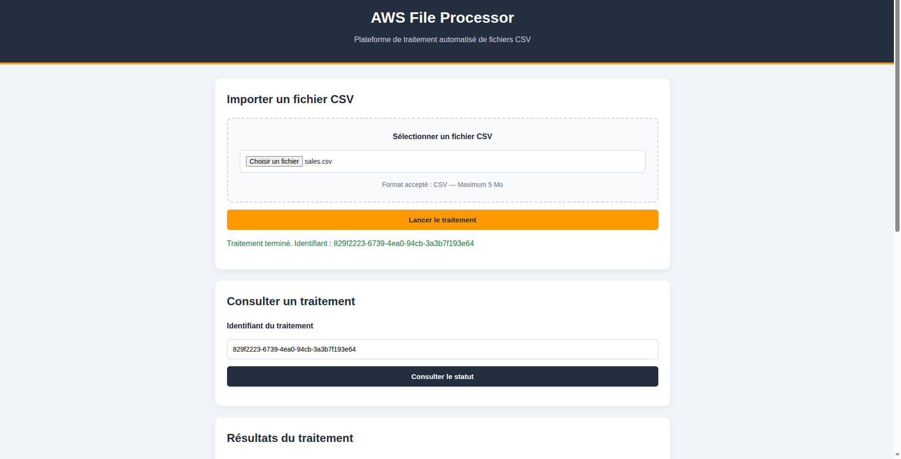
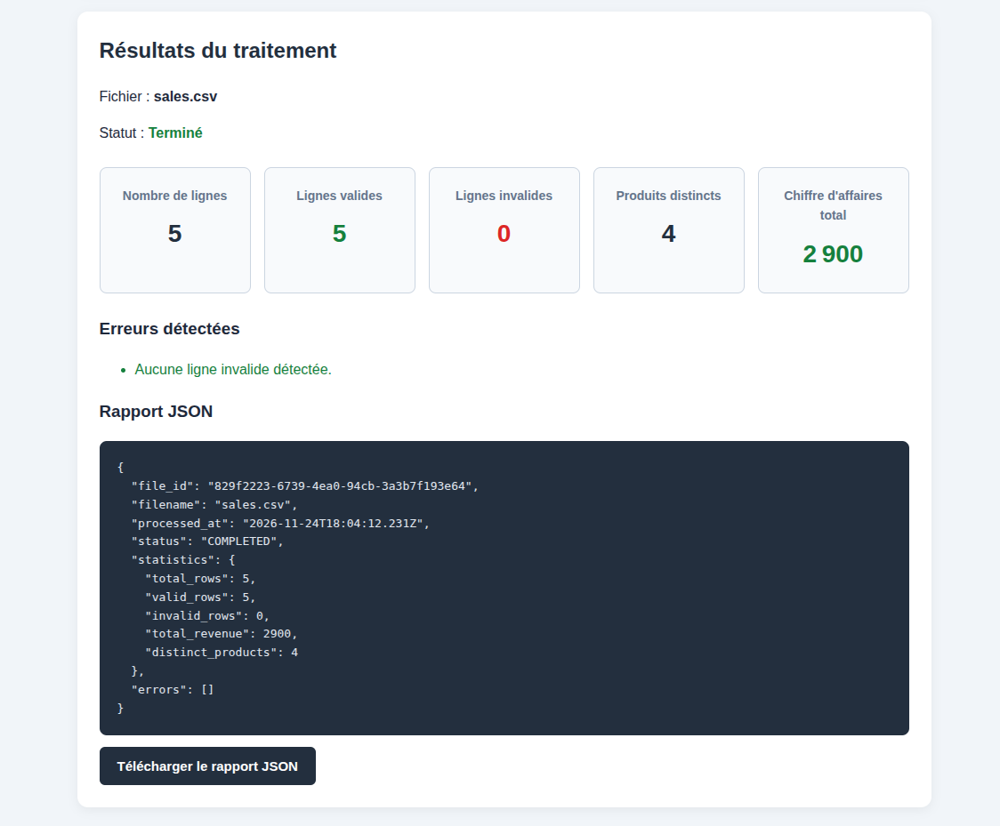
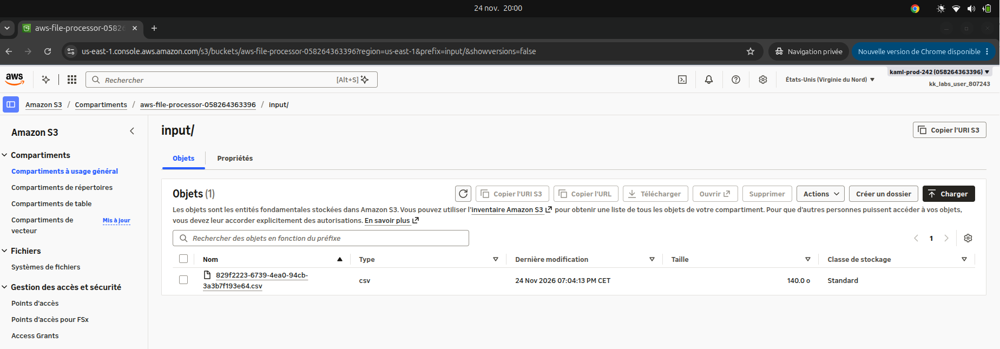
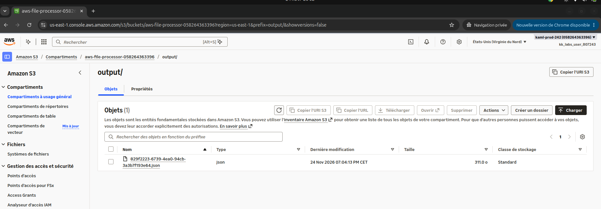
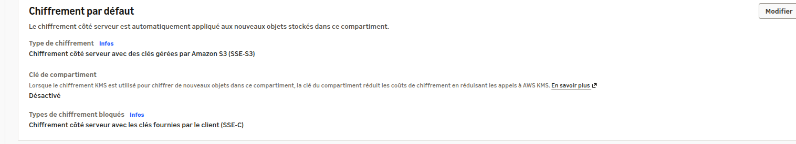
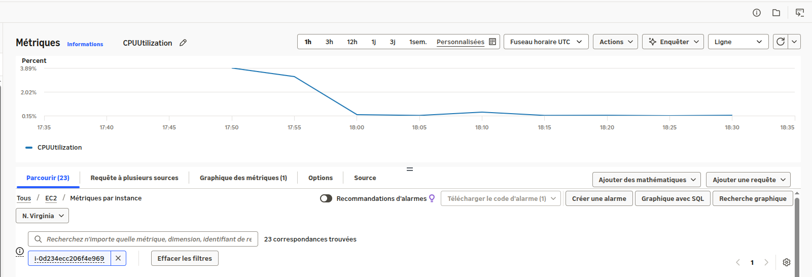
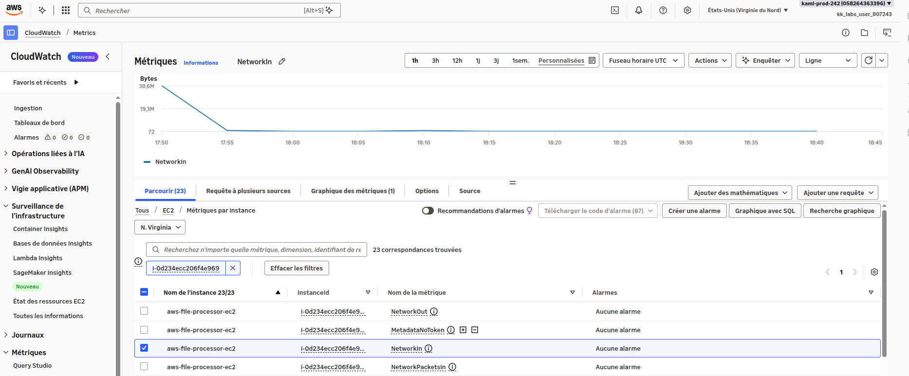

# AWS File Processor

## 1. Présentation du projet

AWS File Processor est une plateforme de traitement automatisé de fichiers CSV déployée sur AWS.

L'utilisateur importe un fichier CSV depuis une interface web. L'application stocke le fichier dans Amazon S3, analyse son contenu, calcule des statistiques et génère un rapport JSON consultable et téléchargeable.

L'objectif principal du projet est de mettre en pratique le déploiement, la sécurisation, l'automatisation et la supervision d'une infrastructure Cloud AWS.

## 2. Architecture et choix techniques



| Technologie | Rôle |
|---|---|
| Amazon EC2 | Hébergement de l'application et traitement des fichiers CSV |
| Amazon S3 | Stockage des fichiers CSV et des rapports JSON |
| AWS IAM | Gestion des identités et des permissions |
| Amazon CloudWatch | Supervision des métriques de l'instance EC2 |
| Terraform | Provisionnement de l'infrastructure AWS |
| Node.js / Express.js | Backend et traitement des fichiers |
| HTML / CSS / JavaScript | Interface utilisateur |
| Python Diagrams | Modélisation de l'architecture |
| Git / GitHub | Gestion des versions |

### Sécurité

- Bucket S3 privé avec blocage des accès publics.
- Chiffrement des objets S3 avec SSE-S3.
- Rôle IAM associé à l'instance EC2.
- Permissions S3 limitées aux opérations nécessaires.
- Absence de clés d'accès AWS statiques dans le code.
- Contrôle des accès réseau avec un Security Group.

## 3. Reproduction de l'environnement

### Prérequis

- Un environnement AWS avec les permissions nécessaires.
- AWS CLI configuré.
- Terraform.
- Git et une paire de clés SSH.

### Provisionnement de l'infrastructure

```bash
git clone https://github.com/denisbyte/aws-file-processor.git
cd aws-file-processor/terraform

terraform init
terraform validate
terraform plan
terraform apply
terraform output
```

Adapter les variables Terraform à son environnement avant le déploiement.

### Déploiement de l'application

Se connecter à l'instance EC2 à l'aide de la commande SSH fournie par Terraform.

```bash
git clone https://github.com/denisbyte/aws-file-processor.git
cd aws-file-processor/backend
npm ci
```

Configurer les variables d'environnement de l'application avec la région AWS, le nom du bucket S3 créé par Terraform et le port 3000.

Démarrer le serveur Node.js, puis accéder à l'adresse fournie par la sortie `application_url` de Terraform.

## 4. Résultats

### Provisionnement avec Terraform

Création réussie de 10 ressources AWS.



### Application déployée sur EC2

Importation et traitement d'un fichier CSV depuis l'interface web.



### Résultats du traitement

Le fichier de test `samples/sales.csv` a produit les résultats suivants :

| Indicateur | Résultat |
|---|---:|
| Nombre de lignes | 5 |
| Lignes valides | 5 |
| Lignes invalides | 0 |
| Produits distincts | 4 |
| Chiffre d'affaires total | 2 900 |



### Stockage Amazon S3

Stockage du fichier CSV dans le préfixe `input/`.



Stockage du rapport JSON dans le préfixe `output/`.



### Chiffrement des données

Chiffrement côté serveur avec des clés gérées par Amazon S3 (SSE-S3).



### Supervision avec Amazon CloudWatch

Suivi de l'utilisation du processeur de l'instance EC2.



Suivi du trafic réseau entrant.



## 5. Limites du projet

- Environnement AWS temporaire fourni par KodeKloud Playground.
- Architecture initialement prévue avec AWS Lambda, adaptée en raison des restrictions IAM du Playground.
- Traitement synchrone des fichiers sur EC2.
- Infrastructure reposant sur une seule instance EC2, sans haute disponibilité.
- Application accessible en HTTP, sans authentification utilisateur.
- Supervision limitée aux métriques d'infrastructure, sans centralisation des logs applicatifs dans CloudWatch.
- Déploiement applicatif manuel après le provisionnement Terraform.
